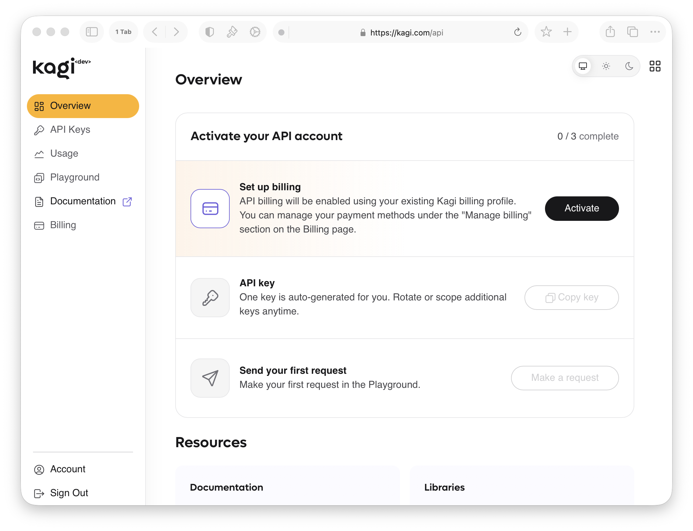

# Quick Start

Get up and running with the Kagi API in a few minutes.

## Step 1: Create a Kagi Account

[Sign up for a Kagi account](https://kagi.com/signup?plan_id=trial) if you don't have one already. A Kagi account is required to access the API portal and generate API keys.

## Step 2: Set Up Your Account

{data-zoomable}

Go to `Settings → API`, or navigate directly to [kagi.com/api](https://kagi.com/api).

### Step 2.1: Add a Payment Method & Activate the API

API usage is billed separately from a Kagi subscription. You can add a payment method from the [API Billing panel](https://kagi.com/api/billing).

Additionally, if you have v0 API credits, they work as credit with the new v1 API so you can activate the API without adding a payment method.

### Step 2.2: Copy Your API Key

An API key is automatically generated for you. Click `Copy key` in the https://kagi.com/api/keys portal and store it somewhere safe.

### Step 2.3: Setup your agent with the MCP server

We have a hosted MCP server that allows your agent to access the API using your new API subscription.

It supports OAuth login with your Kagi account, or you can also use the API key generated above if you wish.

You can view or point your agent at our docs here: https://kagi.com/api/docs/openapi/section/mcp

### Step 2.4 (Optional): Test Your Key in the Playground

The API portal includes a built-in playground where you can run test queries directly in your browser without writing any code. It's a quick way to verify your key is working before integrating.

You can access it at https://kagi.com/api/playground/search

## Step 3: Make Your First API Call

Try a search request with your API key using `curl`:

```shell
curl -i -X POST \
  https://kagi.com/api/v1/search \
  -H 'Authorization: Bearer <YOUR_TOKEN_HERE>' \
  -H 'Content-Type: application/json' \
  -d '{
    "query": "steve jobs"
  }'
```

See the [API reference](https://kagi.com/api/docs) for the full endpoint reference.

## Client Libraries

Jump right in to building with one of our pre-made client libraries.

- [Python](https://github.com/kagisearch/kagi-api-python)
- [Go](https://github.com/kagisearch/kagi-api-golang)
- [Rust](https://github.com/kagisearch/kagi-api-rust)
- [TypeScript](https://github.com/kagisearch/kagi-api-typescript)
- [OpenAPI Spec](https://kagi.com/api/docs/_bundle/openapi.yaml?download)


## Need help? Found a bug?

You can email support@kagi.com at any time for help with setting up the API, or with feature suggestions & bug reports.
