# Using Kagi Mail

<br>

<video src="./media/kagi-mail-overview.mp4" width="720" type="video/mp4" autoplay muted loop playsinline disablepictureinpicture />

Kagi Mail is a private email and calendar service from Kagi. Like Kagi Search, it's paid for by the people who use it, not by advertisers: there are no ads, no tracking, and your mail is never used to build a profile of you.

Most email doesn't need you. Kagi Mail helps you find the email that does. It can hold mail from new senders until you let them in, flag likely phishing, move newsletters into a feed you read when you choose, and show you who's waiting on a reply. The writing always stays yours: when you email someone, they hear from you, in your own words.

Some email services give you good email and nothing more. Others put AI in everything and never ask. Kagi Mail lets you choose: use Inbox Highlights, Preview, Rules, and Ask, or turn every AI feature off with one switch.

Either way, you get private email that fits the way you already work. Use it in your browser at [kagimail.com](https://kagimail.com) or in the email and calendar apps you already use. Give every website its own alias, use your own domain, and move your mail over from Gmail or any other provider. And because it's built on open standards, your mail stays yours to take with you.

With Kagi Mail, you can:

- [See which emails need you](#inbox-highlights), from replies people are waiting on to what's due soon and what to review
- [Know what each email is about](#preview) before you open it, with one-line previews
- [Follow long threads](#thread-visualization) with a map of who's involved and where the conversation split
- [Sort your mail in your own words](#filtering-mail-with-rules), with rules like *"Receipts go in Receipts"*
- [Ask your inbox a question](#ask) and get the answer, with the matching emails listed below it
- [Screen new senders](#triage) before they reach your inbox, with warnings about likely phishing
- [Read newsletters as a feed](#newsletter-view) instead of one at a time
- [Block trackers](#privacy), with tracking pixels removed and remote images loaded through Kagi's proxy
- [Keep your address private](#aliases) with unlimited aliases
- [Email Kagi Assistant](#emailing-kagi-assistant) to find what was decided in a long thread, answer questions about your mail, or tell it how to file future messages in a thread
- [Proofread](#proofreading-a-draft) and [translate](#translating-a-draft) your drafts before you send them
- [Use any email or calendar app](#using-other-email-and-calendar-apps), over IMAP, JMAP, and CalDAV
- [Use your own domains](#custom-domains), with catch-all addresses, shared addresses, and mailing lists
- [Manage your calendar](#calendar) with invitations and sync
- [Work from the keyboard](#keyboard-shortcuts), with a command prompt and shortcuts you can change
- [Import your mail](#importing-your-mail) from Gmail or another provider, and [export it](#exporting-your-mail) any time
- [Try new features in Kagi Mail Labs](#kagi-mail-labs): [Inbox Highlights](#inbox-highlights), [Preview](#preview), [Triage](#triage), [Newsletter view](#newsletter-view), [Thread visualization](#thread-visualization), [Sender brand logos](#sender-brand-logos), [Ask](#ask), and [MCP](#mcp)

Every account includes **50 GB** of storage. Kagi Mail uses your Kagi account and is included with [Kagi Ultimate](#plans-and-limits).

For questions about how Kagi Mail works under the hood, see the [Kagi Mail FAQ](./faq.md).

## Privacy

- **Tracking pixels are removed**, so senders can't tell when or where you opened their email.
- **Remote images load through Kagi's image proxy**, so senders don't see your IP address.
- **No ads and no profiling of your mail.**
- **AI on your terms.** You choose the permissions the [Rules](#filtering-mail-with-rules) feature has, and you can turn each [Kagi Mail Labs](#kagi-mail-labs) feature on or off.
  - To pause all AI features at once, turn off **AI features** in [Settings > General](https://kagimail.com/settings/general). Your choices for each feature are kept for when you turn it back on.

These protections are applied when a message arrives, so they work in every app you use to read your mail. We only use trusted AI providers, and your mail is never used to train AI models.

## Getting Started

Try Kagi Mail free for 60 days with the Kagi Mail plan, or get it included with Kagi Ultimate. See [Plans and Limits](#plans-and-limits).

1. Go to [kagimail.com](https://kagimail.com) and sign in with your Kagi account, or create a new Kagi Mail address.
2. Choose your address, the part before the @. Usernames must be at least **5 characters** long and can't contain `@` or `+`. Some names are reserved.
3. Set a display name. With a display name, your messages are less likely to be flagged as spam by the recipient's email service.
4. If you're new to Kagi, set a password under **Secure your account**. You're also asked how you heard about Kagi. This is optional.

When your address is ready, click **Learn more and customize** for a short tour of aliases, labels and rules, and searching in your own words. It ends with **Choose your settings**, where you pick the appearance and choose whether to turn on AI features, natural language search, and the shortcuts action bar. To skip the tour, click **Go to my inbox**.

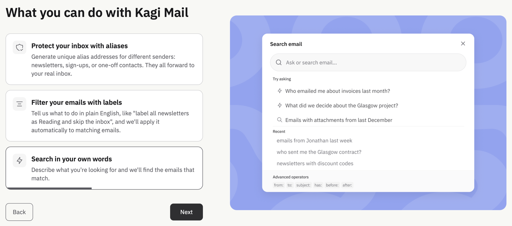{data-zoomable}

Until you start your free trial, you can only send email to Kagi support and to yourself, and a banner at the top of your inbox reminds you. To send and receive mail normally, click **Start trial** in the banner, or **Start free trial** under **Kagi Mail plan** in [Settings > General](https://kagimail.com/settings/general). With Kagi Ultimate, you can send and receive mail right away.

To bring over your mail from another provider, see [Importing Your Mail](#importing-your-mail).

### Onboarding Checklist

When you start using Kagi Mail, an **Onboarding** checklist opens on the right side of the screen. The **Onboarding** button in the top bar shows your progress, for example **0/7**. Click it to show or hide the checklist.

<video src="./media/clip-onboarding-toggle.mp4" width="720" type="video/mp4" autoplay muted loop playsinline disablepictureinpicture />

- **[Import your mail](#importing-your-mail)**
- **[Import your calendar](#importing-a-calendar)**
- **[Create an alias](#aliases)**
- **[Connect a mail app](#using-other-email-and-calendar-apps)**
- **[Set up rules and permissions](#setting-up-rules)** (only appears when AI features are on)
- **[Learn the keyboard shortcuts](#keyboard-shortcuts)**
- **[Check out what we're working on](#kagi-mail-labs)**, which opens Kagi Mail Labs

Each task links to the right page. Check off tasks yourself as you go. Checking off a task doesn't change any settings.

The checklist is stored in a hidden calendar called **Kagi Mail Onboarding**. Kagi Mail doesn't show it in your calendar, but other calendar or reminder apps that sync with Kagi Mail may show its items. To remove the checklist when you're done, delete the **Kagi Mail Onboarding** calendar in [Calendar settings](https://kagimail.com/calendar/settings).

## Navigating Kagi Mail

- Your mailboxes and labels are in the sidebar on the left.
- Your storage usage is shown in the bottom-left corner.
- Settings are under the gear icon in the top-right corner, grouped into **Interface**, **Mail**, and **Account**.

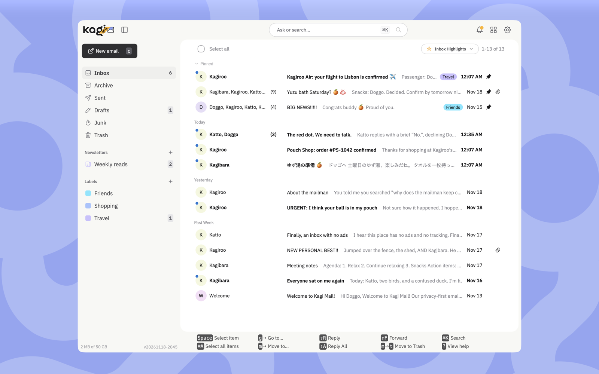{data-zoomable}

Kagi Mail's interface was inspired by terminal apps, and a few features are only available from the keyboard. Press <kbd>?</kbd> at any time to see every shortcut and command. See [Keyboard Shortcuts](#keyboard-shortcuts).

### Customizing the Appearance

In [Settings > Appearance](https://kagimail.com/settings) you can change:

- **Theme**: Default, Light, or Dark
- **Fonts**: one font for the interface (**UI Font**) and one for message text (**Content Font**)
- **Email view**: whether messages open in HTML instead of text view
- **Show Previews**: whether the inbox list shows the first lines of each message

Desktop notifications for new mail are under **Notifications** in [Settings > Messages & Composing](https://kagimail.com/settings/mail). Your browser and operating system control whether they appear. The **Shortcuts action bar**, which shows on-screen hints for the keyboard shortcuts you can use on the current screen, is in [Settings > Keyboard Shortcuts](https://kagimail.com/settings/keybinds).

### Opening Email Links in Kagi Mail

To open `mailto:` links in Kagi Mail instead of your device's default email app, go to [Settings > Messages & Composing](https://kagimail.com/settings/mail) and click **Use Kagi Mail** under **Email links**. Your browser asks you to allow it. To undo this, click **Stop using Kagi Mail**.

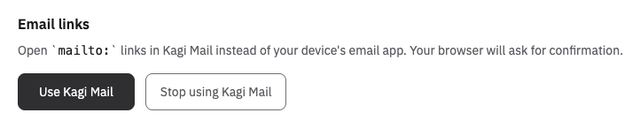{data-zoomable}

This option is available in desktop browsers that support it, including Chrome, Edge, Firefox, Opera, and Brave, and in Firefox for Android.

Safari, Orion, Chrome for Android, and browsers on iPhone and iPad don't support it, so the option doesn't appear there.

This applies to email links you click in that browser. To also open email links from other apps in Kagi Mail, make that browser your default email app: on Windows, set **MAILTO** to your browser in **Settings > Apps > Default apps**; on a Mac, open Apple Mail and choose your browser under **Settings > General > Default email reader**.

## Importing Your Mail

You can bring your existing mail into Kagi Mail from Gmail, Outlook, iCloud Mail, Yahoo Mail, Fastmail, Proton Mail, AOL Mail, Tuta, or any other email account. To bring over your calendar too, see [Importing a Calendar](#importing-a-calendar).

### Connecting Your Old Account

Connecting your old account is the recommended way. Kagi Mail imports your existing mail and keeps checking for new mail every few minutes, so you can switch gradually.

1. Go to [Settings > Import & Export](https://kagimail.com/settings/import-export) and click **Import email**.
2. Choose your provider, then choose to connect it.
3. Follow the steps shown to create an app password, then click **Connect email account**.
4. Enter your email address. Kagi Mail finds the server settings for you.
5. Enter your password or app password.
6. Turn on the folders you want to import, and choose a Kagi Mail mailbox for each one. Standard folders such as Inbox and Sent are matched for you.

The import keeps running after you close the page. Mail from Gmail is filed by your Gmail labels, and mail without a label goes to **Archive**.

To stop importing, turn off the folders on the import's page, or go to **Manage imported accounts** in [Settings > Import & Export](https://kagimail.com/settings/import-export) and delete the import.

Kagi Mail stores your old account's password encrypted. Signing in with your provider's account (OAuth) isn't supported yet, which is why the steps use an app password.

### Uploading an Export File

You can also import an MBOX file, which most providers let you download. After you choose your provider, choose to upload an export file instead of connecting. The messages are placed under a new label for that import, and [Settings > Job History](https://kagimail.com/settings/jobs) shows the progress.

If some messages couldn't be imported, click **What failed** on the import in Job History to see which ones and why, for example because your mailbox is full. Importing the same file again adds only the messages that are still missing.

The MBOX format doesn't store read/unread status, labels, or flags. Kagi Mail keeps this information where it can recognize a provider's conventions, but some of it may be lost.

## Reading Mail

Kagi Mail opens HTML email in text view by default. Messages are converted to plain text with links and basic formatting such as bold and lists, without images or tracking.

- To see the original design, press <kbd>V</kbd> or choose **View HTML** from the message menu. Press <kbd>V</kbd> again to switch back.
- To always show HTML, turn on **Email view** in [Settings > Appearance](https://kagimail.com/settings). You can still switch individual threads with <kbd>V</kbd>.

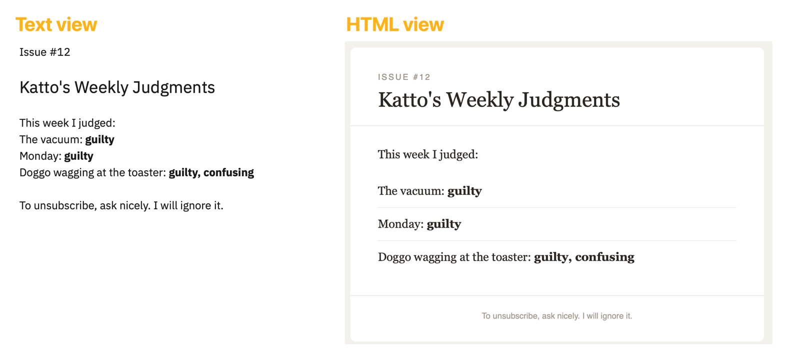{data-zoomable}

Plain-text messages written in Markdown are displayed with their formatting.

To hide the message previews in your inbox list, turn off **Show Previews** in [Settings > Appearance](https://kagimail.com/settings). This setting is saved per browser.

### Translating Messages

Messages that arrive in another language offer a translation into English, powered by [Kagi Translate](../translate/index.md). For each language, choose **Always translate** or **Never**. You can change this under **Translation** in [Settings > Messages & Composing](https://kagimail.com/settings/mail).

<video src="./media/clip-translation.mp4" width="720" type="video/mp4" autoplay muted loop playsinline disablepictureinpicture />

## Writing Email

Click **New email** or press <kbd>C</kbd>. The toolbar has font and text size, bold, italic, underline, strikethrough, subscript and superscript, alignment, lists, links, and inline images. To attach files, click the paperclip icon in the bottom-right corner of the compose window: up to **5 files** per upload, **50 MB** per file, and **75 MB** in total per email.

To write a plain-text email instead, press <kbd>:</kbd> and run `compose-text`.

If you have more than one address (your primary address, aliases, or addresses on your own domains), choose the one to send from in the **From** field. Each address can have its own display name and signature. Set them for your primary address in [Settings > Primary Address](https://kagimail.com/settings/primary-address), and for an alias on the alias's edit page in [Settings > Aliases](https://kagimail.com/settings/aliases).

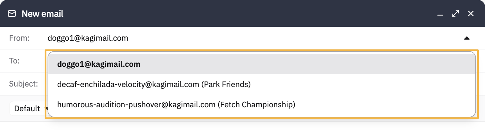{data-zoomable}

### Proofreading a Draft

To check your draft for mistakes, click the **Proofread** icon in the bottom-right corner of the compose window. The **Proofread message** panel opens.

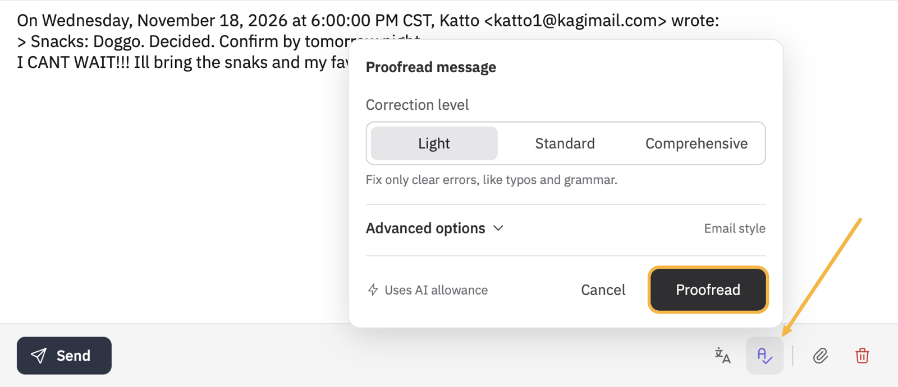{data-zoomable}

1. Choose a **Correction level**:
   - **Light**: fixes only clear errors, like typos and grammar.
   - **Standard**: also improves clarity and readability.
   - **Comprehensive**: also polishes style and tone.
2. Optionally, open **Advanced options** to set the **Writing style** (Email by default), **Formality**, **Reading level**, and **Effort**, or add **Context**, such as who the email is for.
3. Click **Proofread**.

All corrections are applied at once and underlined in your draft. Use the arrows in the bar at the bottom of the compose window to step through them. A card next to each correction explains why it was made. To undo that correction, click **Keep original**. To undo every correction, click **Revert all**. When you're happy with the result, click **Done**.

<video src="./media/clip-proofread.mp4" width="720" type="video/mp4" autoplay muted loop playsinline disablepictureinpicture />

Proofread only checks the text you wrote, not your signature, quoted messages, or forwarded messages.

### Translating a Draft

To write in one language and send in another, click the **Translate** icon in the bottom-right corner of the compose window. The **Translate message** panel opens.

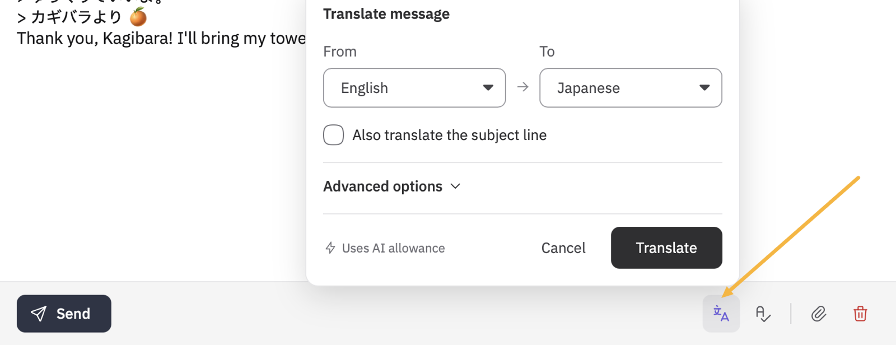{data-zoomable}

1. In **To**, choose the language to translate into. When you reply, it's set to the language of the message you're replying to. **From** is set to **Detect language**, so you only need to change it if the language isn't detected correctly.
2. To translate the subject too, select **Also translate the subject line**.
3. Optionally, open **Advanced options** to set the **Formality**, **Addressee gender**, **Reading level**, and **Effort**, or add **Context**. Some settings may not apply to all languages.
4. Click **Translate**.

The translation replaces your text, and a label above it shows the language it was translated from. If you edit the translation, the label says **Edited manually**. To go back to your own text, click **Restore original**. Translating again starts from your original text and replaces any edits you made to the translation.

<video src="./media/clip-translate-draft.mp4" width="720" type="video/mp4" autoplay muted loop playsinline disablepictureinpicture />

Translate only changes the text you wrote, not your signature, quoted messages, or forwarded messages.

Proofread and Translate use [Kagi Translate](../translate/index.md). On Kagi Ultimate, they count toward your plan's AI allowance. They're only available when **AI features** is on in [Settings > General](https://kagimail.com/settings/general).

### Undoing a Sent Email

After you click **Send**, you have **15 seconds** to change your mind. To stop the message, press <kbd>:</kbd> and run `undo`.

To change how long you have, set **Undo send** in [Settings > Messages & Composing](https://kagimail.com/settings/mail) to 5, 10, 15, 30, or 60 seconds, or turn it off.

## Organizing Mail

Kagi Mail has the standard mailboxes (**Inbox**, **Sent**, **Drafts**, **Archive**, **Junk**, and **Trash**), and you organize everything else with labels.

- A message can have any number of labels, and it appears under each one.
- Labels can be nested, for example `Work/Clients`.
- Labels under **Inbox**, such as `Inbox/Updates`, split your inbox into sections.
- In other email apps, labels appear as folders.

To create a label, click **+** next to **Labels** in the sidebar. To label a message, right-click it and choose **Apply labels**, or press <kbd>Shift</kbd> + <kbd>L</kbd>.

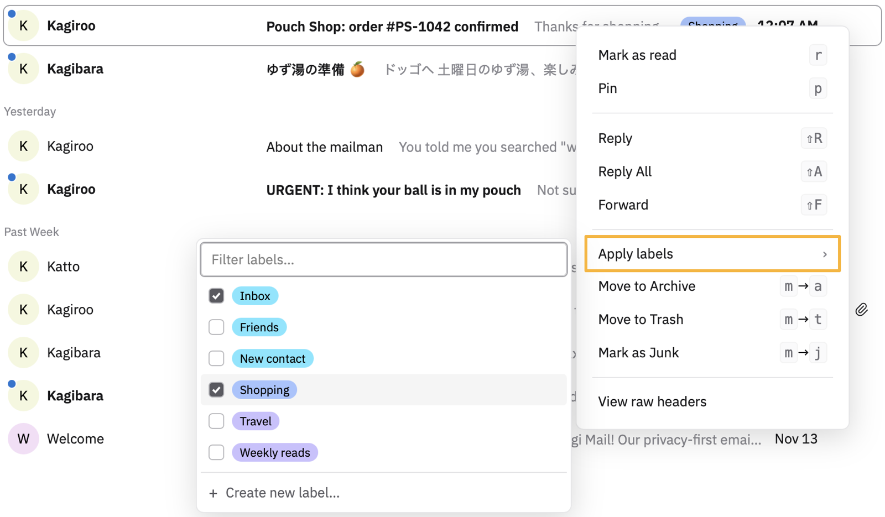{data-zoomable}

The right-click menu also has **Mark as unread**, **Pin**, **Reply**, **Reply All**, **Forward**, **Move to Archive**, **Move to Trash**, **Mark as Junk**, and **View raw headers**, each with its keyboard shortcut.

Pinned messages stay at the top of your inbox. Press <kbd>P</kbd> to pin a message and <kbd>Shift</kbd> + <kbd>P</kbd> to unpin it. Messages you flag or star in another email app connected to Kagi Mail show up as pinned in Kagi Mail. To collapse the pinned messages, click the **Pinned** heading. Click it again to expand them.

<video src="./media/clip-pinned-collapse.mp4" width="720" type="video/mp4" autoplay muted loop playsinline disablepictureinpicture />

Messages you starred in your old account aren't pinned when you [import your mail](#importing-your-mail). They're added to a **Starred** label instead, and also stay in their usual mailbox.

To file mail automatically, use [Rules](#filtering-mail-with-rules) or [Sieve filters](#filtering-mail-with-sieve).

## Searching Mail

Click the search bar at the top or press <kbd>Ctrl</kbd> + <kbd>K</kbd>. To narrow your results, use search operators. For example, `from:alex@example.com` finds messages from that sender. Search suggestions list the operators you can use.

| Operator | Finds messages |
| --- | --- |
| `from:`, `to:`, `cc:`, `bcc:` | From or to a person or address |
| `subject:` | With words in the subject |
| `has:attachment` | With attachments |
| `is:read`, `is:unread` | That are read or unread |
| `size:` | Larger than a size, for example `size:5mb` |
| `mailbox:`, `label:` | In a mailbox or with a label |
| `before:`, `after:` | Before or after a date, for example `after:2026-10-01` or `after:3 weeks ago` |

All search terms must match, so `from:alex has:attachment` finds messages from Alex with attachments. To match either term, put `OR` in capital letters between them.

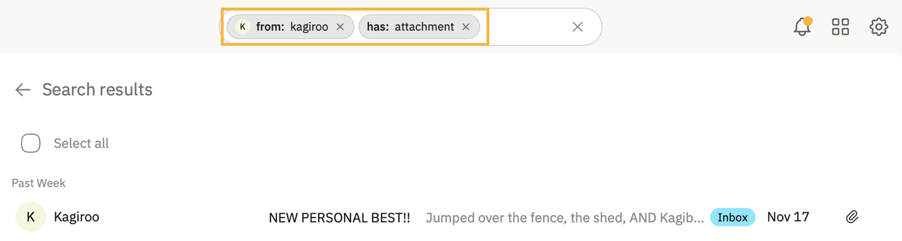{data-zoomable}

To search by describing what you're looking for in your own words, or to ask a question about your mail, turn on **Natural language search** in [Settings > Labs](https://kagimail.com/settings/experiments). See [Ask](#ask).

## Aliases

Aliases let you give a different address to every website, newsletter, or contact. Mail sent to an alias arrives in your inbox, so your main address stays private. If an alias starts getting spam, you know who shared it, and you can turn it off.

To create an alias:

1. Go to [Settings > Aliases](https://kagimail.com/settings/aliases).
2. Click **Create new alias**.
3. Choose a domain: `kagimail.com` or one of your [custom domains](#custom-domains).
4. Use the generated address, such as `harbor-comet-velvet@kagimail.com`, or type your own.
5. Optionally, add a name and description, for example *Online Shopping*, to remember where you used it.

<video src="./media/clip-create-alias.mp4" width="720" type="video/mp4" autoplay muted loop playsinline disablepictureinpicture />

The alias list shows how many emails each alias has received and when the last one arrived. To stop an alias from receiving mail without deleting it, turn off its **Enabled** toggle. To find an alias, type in the **Filter aliases** box.

### Sending from an Alias

In Kagi Mail, choose the alias in the **From** field when you write an email.

Other email apps can't find your aliases automatically, so add each alias you want to send from in the app's settings. For example, in Apple Mail on a Mac:

1. Go to **Mail > Settings > Accounts**.
2. Select your Kagi Mail account.
3. Choose **Email Address > Edit Email Addresses...** and add the alias.

The alias now appears in the **From** field when you write an email.

## Spam and Junk

Kagi Mail filters spam automatically. To see why a message was marked as spam, right-click it and choose **View spam results**. Kagi Mail shows the message's spam score and each rule that added to it, such as a failed DMARC check or a blocklist hit.

If a message was marked as spam by mistake, move it back to your inbox.

To empty the **Junk** mailbox, open it and click **Empty Junk**.

### Blocking and Allowing Senders

When you move a message to **Junk**, its sender is added to your block list, and their future mail goes straight to **Junk**. You can also block or allow a sender from the thread's actions, from a [Triage](#triage) card, or with these [commands](#using-the-command-prompt):

- `block` and `unblock` add or remove a sender from your block list.
- `allow` and `unallow` add or remove a sender from your allowed senders. Mail from allowed senders always reaches your inbox.

## Filtering Mail with Rules

Rules let you describe in plain language what should happen to incoming mail, the way you'd brief an assistant. For example: *"Label anything where users send product feedback, and skip the inbox."* When a message arrives, Kagi Assistant reads it and applies your rules.

Rules can apply labels, skip the inbox, mark messages as read, important, pinned, or junk, and group related emails into one thread. They work on new mail as it arrives, not on mail already in your mailbox. Rules can't forward, reply to, or send mail; for that, use [Sieve filters](#filtering-mail-with-sieve).

### Setting Up Rules

Rules only run when **AI features** is on in [Settings > General](https://kagimail.com/settings/general), and you've turned on at least one permission and at least one rule.

1. Go to [Settings > Rules & Filters](https://kagimail.com/settings/rules).
2. Next to **Permissions**, click **Edit** and turn on what Rules may do.
3. Click **Create rule** and describe what you want.

<video src="./media/clip-create-rule.mp4" width="720" type="video/mp4" autoplay muted loop playsinline disablepictureinpicture />

When a matching email arrives, the rule files it for you:

<video src="./media/clip-rule-in-action.mp4" width="720" type="video/mp4" autoplay muted loop playsinline disablepictureinpicture />

Under **Built-in Rules**, Kagi Mail also has ready-made rules you can turn on:

- One that files automated notifications, order confirmations, shipping updates, and no-reply mail under **Inbox/Updates** and skips the inbox
- One that marks Google Calendar sync emails as read and skips the inbox
- One that groups order confirmations and updates for the same order into one thread

Each rule lists the permissions it needs.

### Permissions

A rule can only do what its permissions allow. If a rule asks for something that isn't allowed, it doesn't happen. Turn on the permissions your rules need:

| Permission | What it allows |
| --- | --- |
| **Read message contents** | Reading the body of the incoming message |
| **Read full thread** | Reading the rest of the conversation |
| **Search for other messages** | Looking up related messages in your mailbox |
| **Create new labels** | Creating labels that don't exist yet |
| **Apply labels** | Adding labels to the message |
| **Skip inbox** | Keeping the message out of your inbox |
| **Mark read** | Marking the message as read |
| **Mark important** | Marking the message as important, which shows in other email apps |
| **Mark as junk** | Moving the message to **Junk** |
| **Pin** | Pinning the message, which shows as a flag or star in other email apps |
| **Set thread** | Adding the message to an existing conversation (needs **Search for other messages**) |

Without **Read message contents**, rules only see the sender, recipients, and subject. To stop Rules from processing your mail, turn off its permissions.

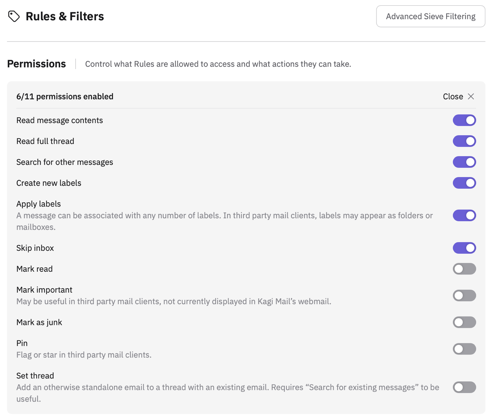{data-zoomable}

### Tips for Writing Rules

- Write the rule the way you'd explain it to a person.
- Depending on the permissions you've turned on, a rule can refer to the message content, the rest of the thread, the message headers, and the people in the conversation.
- A rule can also refer to the address a message was delivered to, which helps for mail sent to an alias, a mailing list, or you as a BCC. For example: *"Label everything delivered to harbor-comet-velvet@kagimail.com as Shopping."*
- Keep each rule short and focused on one task.

## Emailing Kagi Assistant

You can ask Kagi Assistant about your email. Add `assistant@kagimail.com` to a thread with **Reply**, CC, or **Forward**, and ask your question. For example: *"What did we decide in this thread, and what's still open?"*

<video src="./media/clip-ask-assistant.mp4" width="720" type="video/mp4" autoplay muted loop playsinline disablepictureinpicture />

### Giving Instructions for a Thread

You can also tell Kagi Assistant how to file new messages in one thread. Let's say you want future messages in an order thread to be labeled:

1. Reply to the thread and add `assistant@kagimail.com`.
2. Write the instruction, for example *"Label new messages in this thread as Receipts."*
3. Send the message.

New messages that arrive in the thread follow the instruction. Thread instructions don't appear in your list of rules.

For thread instructions to work:

- **AI features** is on in [Settings > General](https://kagimail.com/settings/general).
- The **Read message contents** and **Read full thread** permissions are on in [Settings > Rules & Filters](https://kagimail.com/settings/rules).
- The action is allowed by your [permissions](#permissions), such as **Apply labels**, **Skip inbox**, or **Mark read**.

## Kagi Mail Labs

Kagi Mail Labs is where we test new features before they become part of Kagi Mail. Turn them on or off in [Settings > Labs](https://kagimail.com/settings/experiments), where each feature also has a **Share feedback** link. Kagi Mail Labs features are experimental and may change.

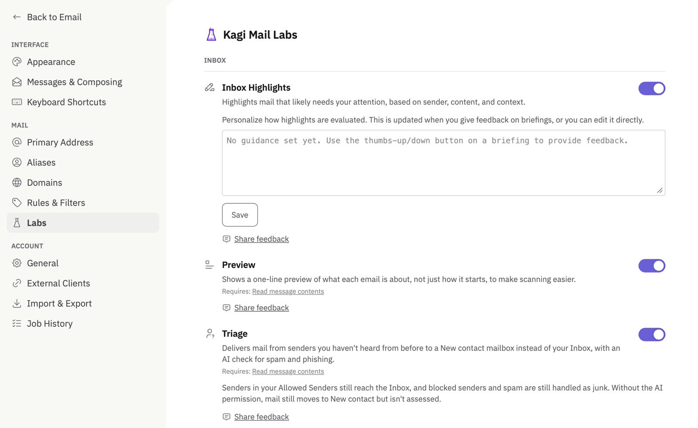{data-zoomable}

| Feature | What it does | Uses AI |
| --- | --- | --- |
| [Inbox Highlights](#inbox-highlights) | Shows the mail that most likely needs your attention | Yes |
| [Preview](#preview) | Shows a one-line preview of what each new email is about, not only how it starts | Yes |
| [Triage](#triage) | Holds mail from new senders until you approve them, and checks it for spam and phishing | Optional (only for the spam and phishing check) |
| [Newsletter view](#newsletter-view) | Shows newsletters as a feed you can scroll through | No |
| [Thread visualization](#thread-visualization) | Shows a conversation as a map of who was involved over time | Optional (only for strand summaries on hover) |
| [Sender brand logos](#sender-brand-logos) | Shows a sender's verified brand logo instead of the letter avatar | No |
| [Ask](#ask) (Natural language search) | Lets you search by describing what you're looking for, or ask a question about your mail | Yes |
| [MCP](#mcp) | Lets your own AI assistant read your mail | Yes, your assistant's |

### Inbox Highlights

**Inbox Highlights** uses AI to show the mail that most likely needs your attention. Click the **Inbox Highlights** button in the top right of your inbox. Highlights are grouped into **Replies**, **Time-sensitive**, and **To review**. Click a highlight to open the email it's about. When you dismiss a highlight or rate a briefing under **Was this helpful?**, Inbox Highlights updates your preferences to shape future highlights. You can see and edit these preferences in [Settings > Labs](https://kagimail.com/settings/experiments).

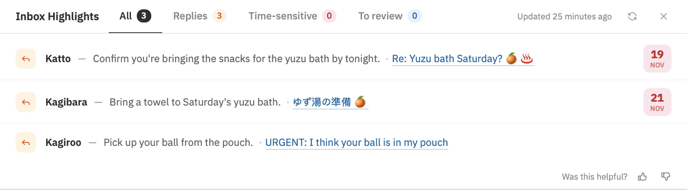{data-zoomable}

### Preview

**Preview** uses AI to replace the first lines of each email in your inbox list with a one-line preview of what the email is about, not only how it starts. It applies to new mail and needs the **Read message contents** permission from [Rules](#permissions).

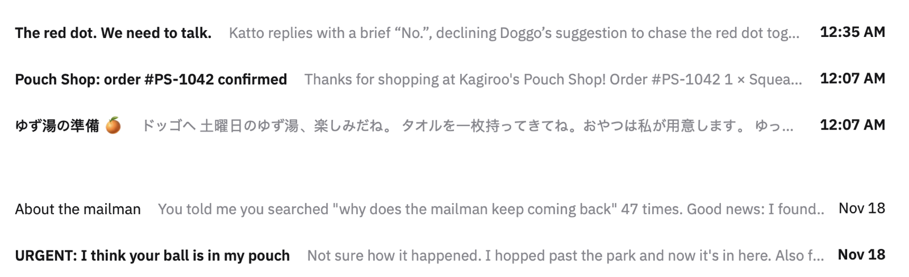{data-zoomable}

This is different from the **Show Previews** setting in [Settings > Appearance](https://kagimail.com/settings), which turns the preview line in your inbox list on or off.

### Triage

**Triage** holds mail from senders you haven't heard from before until you approve them, and uses AI to check it for spam and phishing. Senders you've [allowed](#blocking-and-allowing-senders) still reach your inbox.

When mail from new senders is waiting, a **Screen first-time senders** button appears at the top of your inbox, with the number of messages waiting. Click it to open the **First-Time Contact Screening** page. Each sender has a card with a short note about their message. If the message looks like phishing, the note starts with **Critical:** and shows a warning icon.

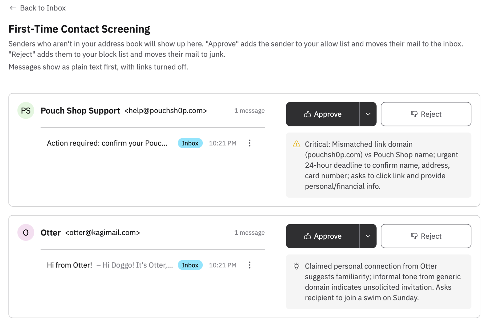{data-zoomable}

Mail waits on this page until you decide. On each card, click:

- **Approve** to add the sender to your allowed senders and move their mail to your inbox. To allow everyone at the sender's domain instead, use the menu next to **Approve**. Only do this if you trust everyone at that domain, since shared email providers include strangers.
- **Reject** to add the sender to your blocked senders and move their mail to **Junk**.

<video src="./media/clip-triage.mp4" width="720" type="video/mp4" autoplay muted loop playsinline disablepictureinpicture />

A warning icon next to the sender's address is a separate check: it means Kagi Mail couldn't confirm the email came from the sender shown. This can happen with forwarded emails, or when the sender's email service isn't set up for verification, so it doesn't necessarily mean the email is fake.

Triage needs the **Read message contents** permission from [Rules](#permissions). Without it, mail from new senders still waits for you to approve it, but it isn't checked and no note appears.

### Newsletter View

**Newsletter view** shows newsletters as a feed of full messages you can scroll through, instead of opening them one by one. To set it up, click **+** next to **Newsletters** in the sidebar to create a newsletter label, or move an existing label there. Kagi Mail offers to create a rule that files the sender's future newsletters there. A message leaves the feed once you open it or mark it as read.

<video src="./media/clip-newsletter-view.mp4" width="720" type="video/mp4" autoplay muted loop playsinline disablepictureinpicture />

### Thread Visualization

**Thread visualization** shows a conversation as a map of who's involved, where it branches, and what's still waiting on a reply. Click **Show tree** in any thread with two or more messages to see it.

Messages between the same group of people form a strand. A new strand starts when people are added to or removed from the thread, or after a long pause in the conversation.

- **Hover over a dot** to see who sent that message and when.
- **Click a dot** to jump to that message in the thread.
- **Click the eye icon** next to a strand to show only that strand's messages.
- If AI features are on, hovering over a dot or eye icon also shows a short summary of what was discussed in that strand, including any decisions or action items.

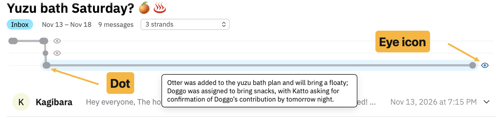{data-zoomable}

When a thread has more than one strand, a strands menu appears in the thread's header, next to the message count. Below the strand count (for example, **3 strands**), each entry shows who started the conversation or what changed, such as **+bob**, **−alice**, or **same audience** after a pause. Choose an entry to show only that strand, or choose the strand count to see the whole thread again.

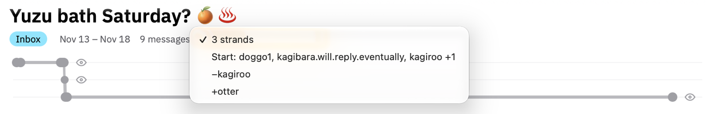{data-zoomable}

### Sender Brand Logos

**Sender brand logos** shows a sender's verified brand logo (BIMI) instead of the letter avatar. The logo is looked up on Kagi's servers, so your browser never contacts the sender's domain.

### Ask

**Ask** uses AI to let you search your mail by describing what you're looking for in your own words, or by asking a question about it. To use it, turn on **Natural language search** in [Settings > Labs](https://kagimail.com/settings/experiments). Your mailbox is then indexed, and the progress is shown under the setting. To run a classic search instead, put your query in quotes or use search operators.

To ask a question, type it in the search bar ending with `?`, for example `When does my flight to Lisbon leave?`. You get an answer based on your emails at the top of the search results, with the matching emails listed below it under **Best matches**.

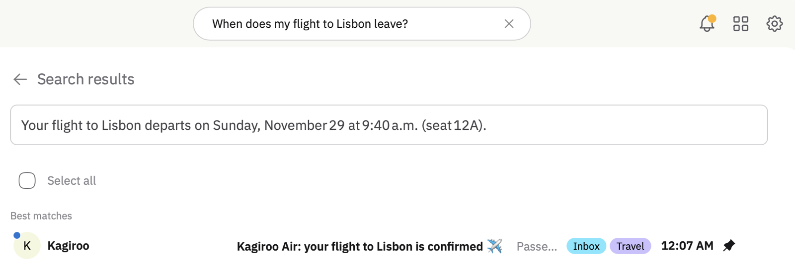{data-zoomable}

### MCP

**MCP** lets your own AI assistant search and read your mail over the [Model Context Protocol](https://modelcontextprotocol.io). Access is read-only, so the assistant can't change, delete, or send email.

When you turn it on in [Settings > Labs](https://kagimail.com/settings/experiments), the MCP section shows the details to connect with, and setup instructions under **Connect an assistant**:

- **Endpoint:** `https://kagimail.com/mcp`
- **OAuth client ID:** `388151328209128068`

To connect an app:

- **Claude Code:**

  ```sh
  claude mcp add --transport http kagimail https://kagimail.com/mcp --client-id 388151328209128068
  ```

- **Codex:**

  ```sh
  codex mcp add kagimail --url https://kagimail.com/mcp --oauth-client-id 388151328209128068
  ```

- **Claude** (claude.ai, desktop, and mobile): go to **Settings > Connectors > Add custom connector**. Paste the endpoint, then the client ID under **Advanced settings**, and leave the client secret blank.
- **ChatGPT:** go to **Settings > Apps & connectors > Advanced**, turn on developer mode, then click **Create connector** and paste the endpoint and client ID.

Other apps need both the endpoint and the client ID, and you then sign in with your Kagi account. Apps that can't take a client ID can't connect.

## Calendar

Kagi Mail includes a calendar. To open it, click the Kagi products button in the top bar and choose the calendar, or go to [kagimail.com/calendar](https://kagimail.com/calendar). You can:

- Create single and repeating events
- Invite people and see their responses
- Get email reminders
- Keep several calendars, each with its own color
- Sync with any CalDAV calendar app, such as Apple Calendar or Thunderbird

To create an event, click **New event** or press <kbd>C</kbd>. You can view your calendar by day, week, month, or year, or as an agenda. To add a calendar, click **+** next to **My calendars**. Click a calendar's checkbox to show or hide its events.

When you receive an invitation, Kagi Mail shows the event details and who's attending. Under **Going?**, choose **Yes**, **Maybe**, or **No** to reply.

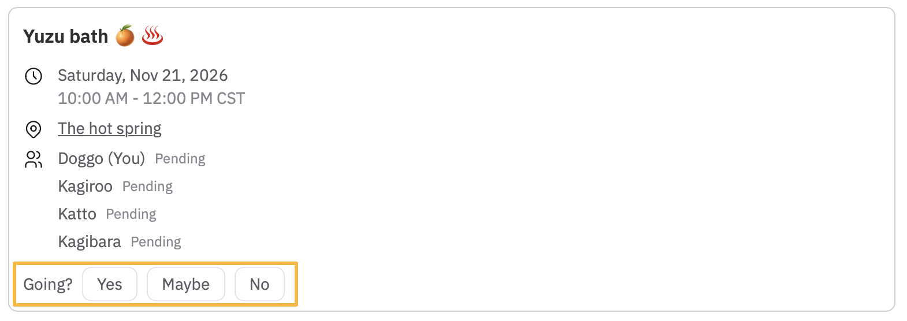{data-zoomable}

Tasks aren't supported yet.

To sync your calendar with another app:

- **iPhone, iPad, or Mac**: use the configuration profile from [Settings > External Clients](https://kagimail.com/settings/external-clients). See [Using Other Email and Calendar Apps](#using-other-email-and-calendar-apps).
- **Other calendar apps**: add a CalDAV account with `mail.kagimail.com` as the server, and sign in with your Kagi Mail address and an [app-specific password](#using-other-email-and-calendar-apps). Apps that support automatic setup find the server from your address.

### Importing a Calendar

You can bring events over from another calendar, such as Google Calendar or Apple Calendar:

1. Export your calendar from your current service as an iCalendar (`.ics`) file. Google Calendar exports a ZIP file of them, which you can import as is.
2. Go to [Calendar settings > Import](https://kagimail.com/calendar/settings/import).
3. Click **Choose file** and select the file.

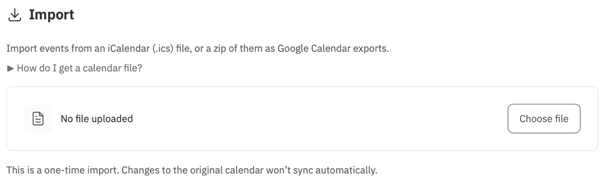{data-zoomable}

If you're not sure how to get the file, open **How do I get a calendar file?** on the same page.

This is a one-time import. Changes you make later in your old calendar aren't copied to Kagi Mail. To keep seeing a calendar that changes, subscribe to it instead.

### Subscribing to Other Calendars

You can add a public calendar, such as a holiday calendar or one someone shared with you as a link. It shows up next to your own calendars and stays up to date.

1. In the calendar sidebar, click **+** next to **Other calendars**, then **Add calendar by URL**.

   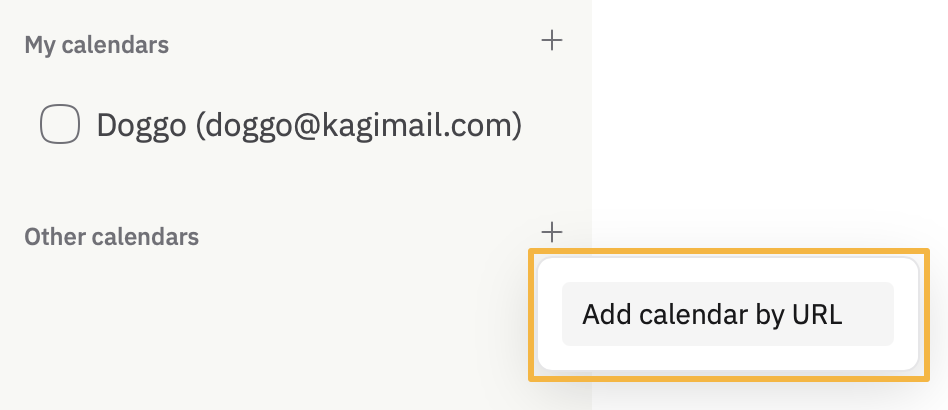{data-zoomable}

2. Paste the **Calendar address**, for example `https://example.com/calendar.ics`.
3. Optionally, choose a **Color**.
4. Click **Subscribe**.

The calendar appears under **Other calendars**, and its events show up in your calendar labeled with its name. Kagi Mail keeps it in sync with the address you subscribed to, on a regular schedule rather than instantly.

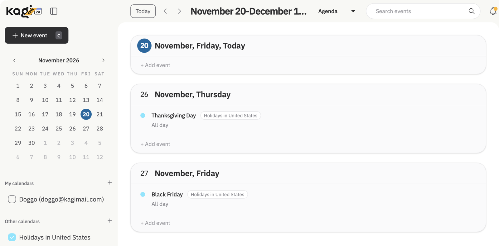{data-zoomable}

To manage your subscriptions, go to [Calendar settings > Subscriptions](https://kagimail.com/calendar/settings/subscriptions). Each one shows when it last synced and when it syncs next.

To remove a subscription, click the trash icon (**Unsubscribe**) next to it and confirm. Its events are removed from your account.

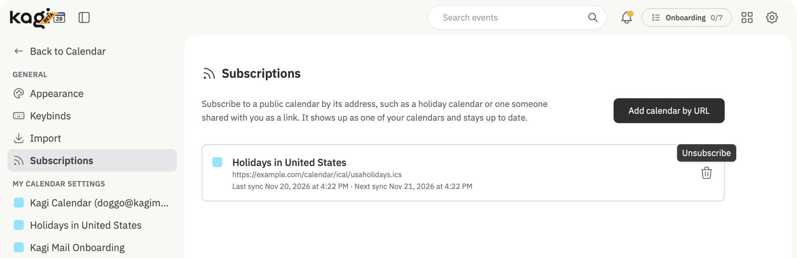{data-zoomable}

### Opening Calendar Links in Kagi Calendar

To open `webcal:` links in Kagi Calendar instead of your device's calendar app, go to [Calendar settings](https://kagimail.com/calendar/settings) and click **Use Kagi Calendar** under **Calendar links**. Your browser asks you to allow it. To undo this, click **Stop using Kagi Calendar**.

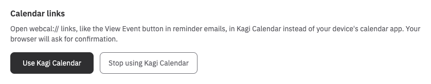{data-zoomable}

Once it's on:

- Links to your own events, such as **View Event** in reminder emails, open the event in Kagi Calendar.
- Links to other calendars open an **External calendar link** page. Click **Subscribe** to [subscribe to the calendar](#subscribing-to-other-calendars), or **Download calendar file** to save it.

This option is available in desktop Chrome, Edge, Firefox, Opera, and Brave, and in Firefox for Android. Like [email links](#opening-email-links-in-kagi-mail), it isn't available in Safari, Orion, Chrome for Android, or browsers on iPhone and iPad.

## Using Other Email and Calendar Apps

Kagi Mail works with the email or calendar app you already use. It supports these open standards:

- **IMAP** for reading and organizing your mail. Most email apps use it.
- **JMAP**, a newer standard for reading and organizing your mail, designed for faster syncing. If your app supports JMAP, you can use it instead of IMAP.
- **SMTP** for sending
- **CalDAV** for your calendar

Any app that supports them can connect to Kagi Mail. [Settings > External Clients](https://kagimail.com/settings/external-clients) has setup notes for:

- Apple Mail (iOS, macOS)
- Thunderbird (Windows, macOS, Linux)
- K-9 Mail and FairEmail (Android)
- Outlook (Windows, macOS)
- Gmail (Android and iOS apps; on the web, you can only add Kagi Mail as a **Send mail as** address)

Email apps sign in with an app-specific password instead of your Kagi account password. Create a separate one for each app or device:

1. Go to [Settings > External Clients](https://kagimail.com/settings/external-clients#app-passwords).
2. Under **App-Specific Passwords**, enter a description, for example *Thunderbird on laptop*.
3. Click **Create App-Specific Password**.
4. In your email app, add an account with your Kagi Mail address and the new password.

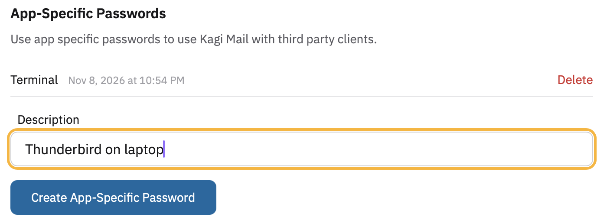{data-zoomable}

To stop an app from signing in, click **Delete** next to its password in [Settings > External Clients](https://kagimail.com/settings/external-clients#app-passwords).

On an iPhone, iPad, or Mac, the quickest way is the configuration profile: in [Settings > External Clients](https://kagimail.com/settings/external-clients), select **Download configuration profile** in the Apple Mail section and open the file. It sets up your mail and calendar together.

Many other apps, including Thunderbird, K-9 Mail, and FairEmail, find the server settings automatically. If yours asks for them, use these. Your username is your full Kagi Mail address.

| Service | Host | Port | Encryption |
| --- | --- | --- | --- |
| IMAP | `mail.kagimail.com` | 993 | TLS/SSL |
| SMTP | `mail.kagimail.com` | 465 | TLS/SSL |
| JMAP | `mail.kagimail.com` | 443 | TLS/SSL |

To sync your calendar, see [Calendar](#calendar).

There is no Kagi Mail mobile app yet. On your phone, use Kagi Mail in your browser or in any IMAP or JMAP app.

## Keyboard Shortcuts

Kagi Mail is designed to be used from the keyboard. Press <kbd>?</kbd> to see every shortcut and command. Menus show each action's shortcut next to it.

Some shortcuts are sequences: press the first key, then the second. For example, <kbd>G</kbd> then <kbd>A</kbd> goes to **Archive**, and <kbd>M</kbd> then <kbd>A</kbd> moves the selected message to **Archive**. On a Mac, use <kbd>⌘</kbd> instead of <kbd>Ctrl</kbd>, and <kbd>⌥</kbd> instead of <kbd>Alt</kbd>.

| Shortcut | Action |
| --- | --- |
| <kbd>C</kbd> | New email |
| <kbd>Ctrl</kbd> + <kbd>K</kbd> | Search |
| <kbd>?</kbd> | View help |
| <kbd>:</kbd> | Command prompt |
| <kbd>Esc</kbd> | Go back |
| <kbd>Space</kbd> | Select item |
| <kbd>Ctrl</kbd> + <kbd>A</kbd> | Select all items |
| <kbd>J</kbd> / <kbd>K</kbd> | Move down / up the list |
| <kbd>H</kbd> / <kbd>L</kbd> | Previous / next thread |
| <kbd>G</kbd> then <kbd>G</kbd> | Go to top |
| <kbd>Shift</kbd> + <kbd>G</kbd> | Go to bottom |
| <kbd>Shift</kbd> + <kbd>R</kbd> | Reply |
| <kbd>Shift</kbd> + <kbd>A</kbd> | Reply all |
| <kbd>Shift</kbd> + <kbd>F</kbd> | Forward |
| <kbd>V</kbd> | Switch between text view and HTML |
| <kbd>R</kbd> / <kbd>U</kbd> | Mark as read / unread |
| <kbd>P</kbd> / <kbd>Shift</kbd> + <kbd>P</kbd> | Pin / unpin |
| <kbd>Shift</kbd> + <kbd>L</kbd> | Apply or remove labels |
| <kbd>D</kbd> | Move to Trash, or delete permanently from Trash |
| <kbd>M</kbd> then <kbd>I</kbd> / <kbd>A</kbd> / <kbd>J</kbd> / <kbd>T</kbd> | Move to Inbox / Archive / Junk / Trash |
| <kbd>G</kbd> then <kbd>I</kbd> / <kbd>S</kbd> / <kbd>D</kbd> / <kbd>A</kbd> / <kbd>J</kbd> / <kbd>T</kbd> | Go to Inbox / Sent / Drafts / Archive / Junk / Trash |
| <kbd>Alt</kbd> + <kbd>H</kbd> / <kbd>J</kbd> / <kbd>K</kbd> / <kbd>L</kbd> | Move focus left / down / up / right |

### Using the Command Prompt

Press <kbd>:</kbd> to open the command prompt, then type a command and press <kbd>Enter</kbd>. Some useful commands:

| Command | What it does |
| --- | --- |
| `compose-text` | Writes a plain-text email |
| `label` | Adds or removes labels |
| `move` | Moves to Inbox, Archive, Junk, Trash, or a label |
| `allow` / `unallow` | Adds or removes a sender from your allowed senders |
| `block` / `unblock` | Blocks or unblocks a sender |
| `headers` | Shows the message's raw headers |
| `undo` | Undoes the last action |
| `goto` | Goes to a mailbox or label |
| `bind` / `unbind` | Adds or removes a keyboard shortcut |

Press <kbd>?</kbd> for the full list.

### Customizing Shortcuts

[Settings > Keyboard Shortcuts](https://kagimail.com/settings/keybinds) lists every action with its command name and current key. Let's say you want <kbd>Ctrl</kbd> + <kbd>F</kbd> to jump to the search bar:

1. Press <kbd>:</kbd> to open the command prompt.
2. Type `bind focus-search` and press <kbd>Enter</kbd>.
3. Press <kbd>Ctrl</kbd> + <kbd>F</kbd>.

<video src="./media/clip-rebind-shortcut.mp4" width="720" type="video/mp4" autoplay muted loop playsinline disablepictureinpicture />

To remove one custom shortcut, run `unbind`. To restore all the defaults, click **Reset all bindings** at the bottom of [Settings > Keyboard Shortcuts](https://kagimail.com/settings/keybinds).

## Custom Domains

Use your own domain, such as `you@yourname.com`, with Kagi Mail. Once the domain is connected, you can create addresses and aliases on it. Setup takes about 5 to 10 minutes, plus the time your DNS changes take to apply.

1. Go to [Settings > Domains](https://kagimail.com/settings/domains) and click **Add domain**.
2. Enter your domain.
3. Add the TXT record shown at your domain provider (such as Cloudflare, Namecheap, or GoDaddy). Its value starts with `kagimail-verification=`.
4. Click **I've added the record**. Kagi Mail checks that you own the domain.
5. Add the DNS records Kagi Mail lists for your domain, then click **Recheck DNS**.

Kagi Mail checks each of these records:

| Record | Purpose |
| --- | --- |
| MX | Routes incoming mail to Kagi Mail servers |
| SPF (TXT) | Lets recipients know Kagi Mail is allowed to send mail for you |
| DKIM (TXT) | Signs your sent mail to prevent spoofing |
| DMARC (TXT) | Sets the policy for handling spoofing attempts |

For any record that is missing or wrong, Kagi Mail shows the expected value next to the value it found, and flags extra records you need to remove. DNS changes usually apply within a few minutes but can take up to 24 hours. To check again later, click **Refresh status** on the [Domains](https://kagimail.com/settings/domains) page.

### Receiving Mail at Any Address

Turn on **Catch-all** for a domain to receive mail sent to any address at that domain that isn't set up, including addresses you haven't created. For example, you can give `bookstore@yourname.com` to a shop without setting it up first.

Catch-all mail arrives in the domain owner's inbox and goes through the same spam filtering, rules, and Triage as the rest of your mail. To find it later, search for the address it was sent to, for example `to:bookstore@yourname.com`. To stop receiving it, turn **Catch-all** off.

### Giving an Address to Someone Else

Each Kagi account has one mailbox, so you can't add mailboxes for other people to your own account. To give someone an address on your domain:

- If they don't have Kagi Mail yet, [set up an address](#setting-up-an-address-for-someone-new) for them. It becomes their own Kagi Mail account.
- If they already have Kagi Mail, [share an address](#sharing-an-address) with them. It's added to their account, and you can take it back at any time.

### Sharing an Address

You can give an address on your domain, such as `john@yourname.com`, to someone who already has Kagi Mail. Mail to that address arrives in their inbox, and they can send from it. Each address goes to one person. To reach several people at one address, such as `family@yourname.com`, create a [mailing list](#creating-a-mailing-list) instead.

1. Go to [Settings > Domains](https://kagimail.com/settings/domains).
2. Click the **Addresses** icon next to the domain.
3. Under **Share an address**, enter the address to share and the person's Kagi Mail address, not a personal email.

The person gets an email letting them know, and the address is added to their aliases, so they can choose it in the **From** field. You can revoke the address at any time from the same page. New mail then stops reaching them, but mail they already received stays in their account.

You can't share an address you use yourself. To give one of your own aliases to someone else, delete it in [Settings > Aliases](https://kagimail.com/settings/aliases) first.

### Setting Up an Address for Someone New

If the person doesn't have Kagi Mail yet, use **Set up an address** on the same page instead. It creates a mailbox at that address, which starts receiving mail right away. Nobody can read it until the person claims it:

1. They set the address as their Kagi account email and verify it.
2. They sign in to Kagi Mail.

A Kagi account holds one mailbox, so they need to do this before creating any other Kagi Mail mailbox. Once claimed, the address is their own Kagi Mail account, so you can't revoke it like a shared address.

### Creating a Mailing List

A mailing list is one address that delivers to all its members, for example `parents@yourname.com`. Click the mailing list icon next to the domain in [Settings > Domains](https://kagimail.com/settings/domains) to create one. Members need an address on the same domain, and you choose who can send to the list: only members, anyone on the domain, or anyone.

## Filtering Mail with Sieve

If you prefer filters that work without AI, use [Sieve](https://www.rfc-editor.org/rfc/rfc5228), a standard scripting language for email filters. Go to [Settings > Rules & Filters](https://kagimail.com/settings/rules) and click **Advanced Sieve Filtering** in the top-right corner.

:::info Note
Sieve is only recommended if you're already familiar with it. Scripts can move, file, or discard mail, and mistakes can be hard to debug.
:::

Write your script in the **Script Content** box, click **Validate** to check it for errors, then click **Save & Activate**.

- Every script starts with a `require` line listing the extensions it uses.
- Use `stop;` to stop processing a message.
- **Sieve Information** on the same page links to the list of supported extensions.
- **Example Snippets** at the bottom of the page has examples you can copy.

For example, this script files everything from one sender under a label:

```sieve
require ["fileinto"];
if address :is "from" "newsletter@example.com" {
  fileinto "Newsletters";
}
```

### Built-in Scripts

Kagi maintains ready-made scripts that update automatically. To use one, `include` it in your script:

```sieve
require ["include"];
include :global "updates";
```

| Script | What it does |
| --- | --- |
| `discard-self-emails` | Discards emails you send to yourself (your email app still saves its copy) |
| `file-calendar-invites` | Files calendar invitations into **Inbox/Events** |
| `google-calendar-sync` | Marks Google Calendar sync emails as read and files them into **Archive** |
| `self-email-todo` | Copies emails you send to yourself into **Inbox/TODO** and discards replies to yourself |
| `updates` | Files mailing-list mail and automated notifications into **Inbox/Updates** |

## Exporting Your Mail

Your mail and calendar are yours. You can export them at any time, or copy them with any IMAP, JMAP, or CalDAV app.

1. Go to [Settings > Import & Export](https://kagimail.com/settings/import-export).
2. Select **Export your Kagi Mail account**.
3. Wait for the export to finish. You can follow its progress in [Settings > Job History](https://kagimail.com/settings/jobs).
4. Download the ZIP file. It stays available for **6 days**.

The ZIP file contains your mail (one MBOX file per folder), your calendars (`.ics` files), and your aliases.

If you cancel Kagi Mail, your data is deleted from Kagi's systems on a defined schedule, so export anything you want to keep before you go.

## Managing Your Account

Kagi Mail uses your Kagi account for sign-in, security, and billing. You can sign in with your Kagi credentials or a social login (Apple, Google, Microsoft, or GitHub).

Under **Kagi account** in [Settings > General](https://kagimail.com/settings/general):

- To change your password or two-factor authentication, click **Password and two-factor authentication**. This opens your Kagi account settings.
- To switch to a different Kagi account, click **Switch Kagi account**.

To delete your Kagi Mail account, go to [Settings > General](https://kagimail.com/settings/general) and click **Delete account…** under **Delete Kagi Mail account**. You'll see what gets deleted before you confirm. This deletes your Kagi Mail address, mail, calendars, and custom domains, but your Kagi account stays active. If your Kagi account signs in with your Kagi Mail address, change it to another email address first. Before you delete, [export your mail](#exporting-your-mail).

## Plans and Limits

Kagi Mail is in public beta.

- **Kagi Mail plan**: try Kagi Mail free for **60 days**, then subscribe for **[TBD]**.
- **Kagi Ultimate**: Kagi Mail is included.

To start the trial, go to [Settings > General](https://kagimail.com/settings/general) and click **Start free trial** under **Kagi Mail plan**. You add a card when you start, but nothing is due until the trial ends.

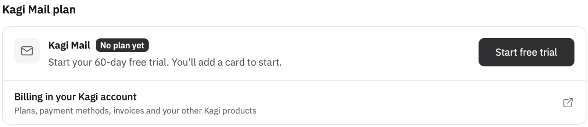{data-zoomable}

On Kagi Ultimate, AI features in Kagi Mail use your plan's [AI allowance](../ai/assistant.md#ai-fair-use-policy).

Limits:

- **50 GB** of storage per account
- **Unlimited** aliases
- **Unlimited** custom domains
- Up to **5 files** per upload when attaching to an email. To attach more, add another batch.
- **50 MB** per attachment
- **75 MB** total attachments per email

To see all Kagi plans, see [Kagi pricing](https://kagi.com/pricing). To manage your plans, payment methods, and invoices, click **Billing in your Kagi account** in [Settings > General](https://kagimail.com/settings/general), or go to [Billing settings](https://kagi.com/settings/billing). To switch plans, use [Plan Selection](https://kagi.com/settings/billing_plan).
