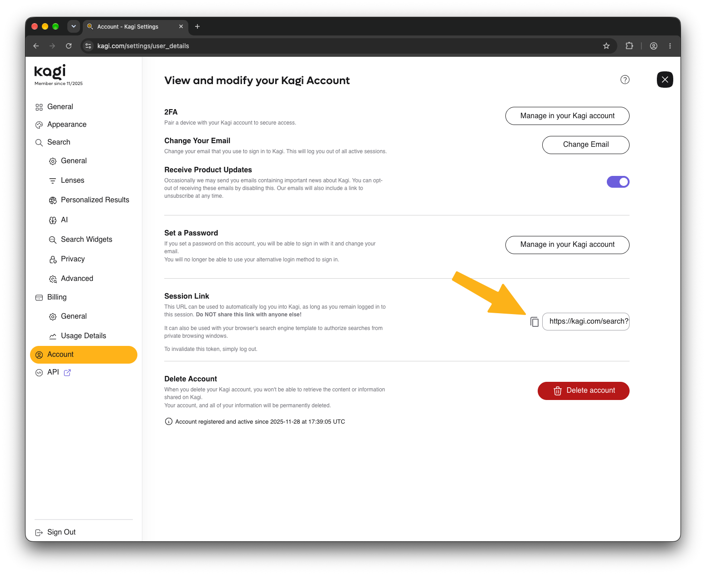
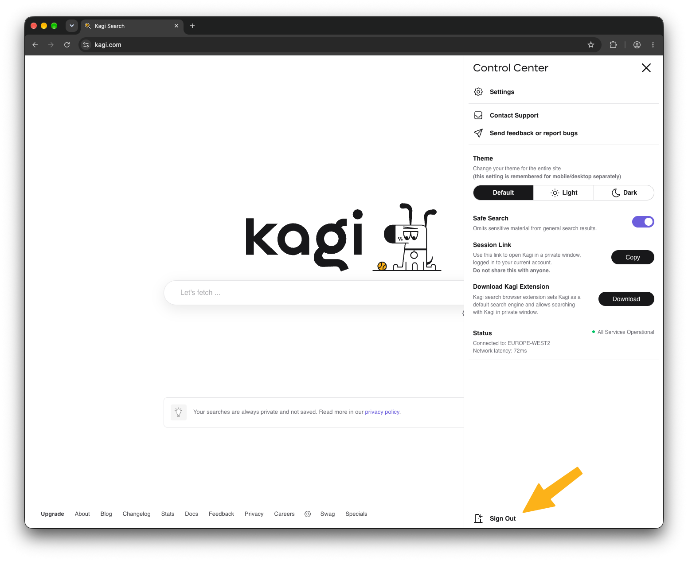

# Private Browser Session Link

The simplest way to use Kagi in a private browser session is to install one of our [browser extensions](../getting-started/setting-default.md#browser_extension) and then add your Session Link to the extension.

However, you can also use the Session Link feature to automatically log in to Kagi when performing a search from a private browsing window, if you prefer manual setup.

## Obtaining a Session Link

{data-zoomable}

A Session Link is a special Kagi URL that contains a "login token."
You can use a Session Link to automatically log into your existing Kagi session from anywhere, including within private browser sessions.

You can copy your Session Link from your [Kagi Search account settings](https://kagi.com/settings/user_details) (`Settings` > `Account`), or click `Copy` next to `Session Link` in the Control Center.

Because a Session Link provides access to your Kagi account, it should always be kept private.

**Never share your Session Link with others.**

To use this link in a browser's custom search engine, you may need to append a placeholder of `&q=%s`, like so:

```
https://kagi.com/search?token=...&q=%s
```

This link will become invalid if you sign out of the session that you copied it from.
Each time you sign in, a new link is generated, so you may need to replace it.

You may have multiple active Session Links by signing in on multiple devices or browsers.

Read on for more details concerning sessions.

## Managing Sessions

A Session Link is attached to the Kagi session it was copied from.
You can Sign Out of that Kagi session if you need to invalidate the Session Link for any reason.

{data-zoomable}

1. Open the session link in a private window
2. Open the Control Center by clicking the icon on the top right of any page
3. Click `Sign Out` to log out and invalidate the link.

{data-zoomable}

Alternatively, you can invalidate all your other sessions at once. Go to [account.kagi.com](https://account.kagi.com/account/security/sessions), open `Security` > `Sessions`, and click `End all other sessions`. You can also click `End` next to a single session.

Sessions will also expire after 90 days of being unused.
