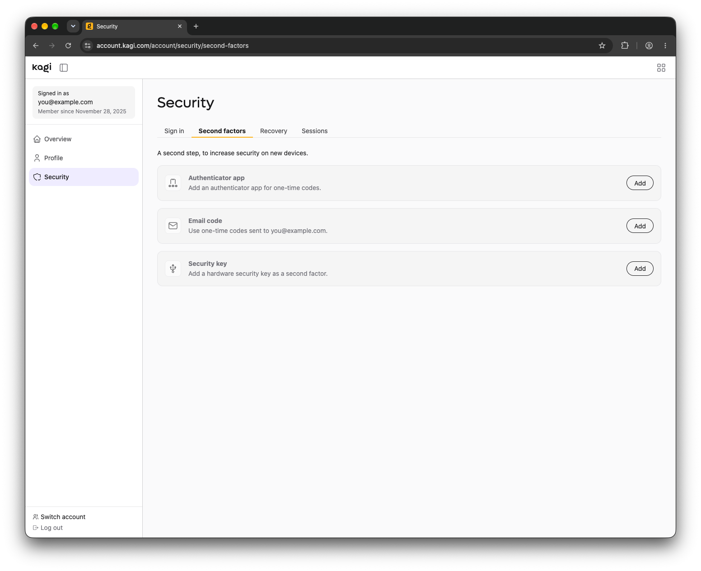
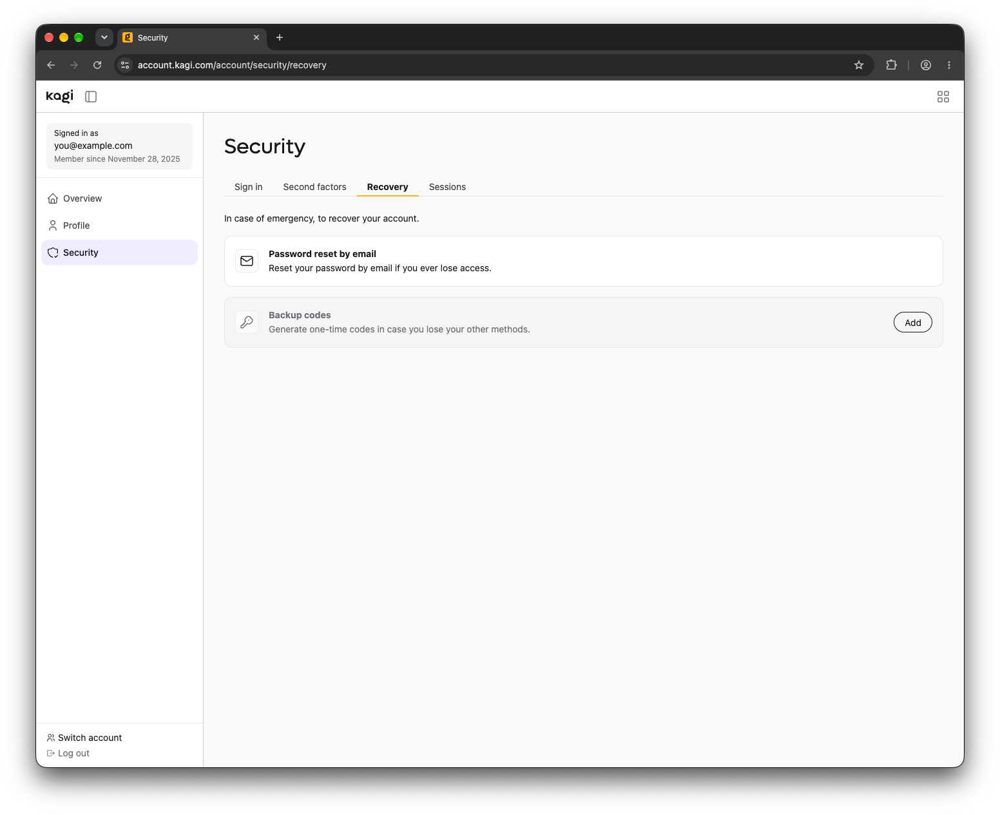

# Two-Factor Authentication (2FA)

Two-factor authentication adds a second step when you sign in on a new device. Even if someone learns your password, they can't sign in without your second factor.

Kagi supports three second factors: an authenticator app, a one-time code sent to your email, or a hardware security key. They are managed in your [Kagi Account](../settings/account.md) at [account.kagi.com](https://account.kagi.com).

::: tip Set up 2FA before September 10th, 2026?
Your authenticator app keeps working, but your old backup codes were not transferred to the new Kagi Account. [Generate new backup codes](#backup-codes) now.
:::

## Setting up 2FA

{data-zoomable}

1. Go to [account.kagi.com](https://account.kagi.com/account/security/second-factors) and open `Security` > `Second factors`.
2. Click `Add` next to the second factor you want to use:
   - `Authenticator app`: Scan the QR code with your [authenticator app](#authenticator-apps), or copy the setup key into it. Then enter the code it generates.
   - `Email code`: Receive one-time codes at your account's email address.
   - `Security key`: Use a hardware security key, such as a YubiKey.
3. Follow the on-screen steps to finish setup.

## Backup codes

{data-zoomable}

Backup codes let you sign in if you lose access to your second factor. Generate them right after setting up 2FA:

1. Go to [account.kagi.com](https://account.kagi.com/account/security/recovery) and open `Security` > `Recovery`.
2. Click `Add` next to `Backup codes`.
3. Store the codes somewhere safe, such as your password manager. Each code can only be used once.

## Signing in with 2FA

When you sign in on a new device, you will be asked for your second factor after entering your email and password.

## Disabling 2FA

Go to [account.kagi.com](https://account.kagi.com/account/security/second-factors), open `Security` > `Second factors`, and remove the second factor you no longer want to use.

## Authenticator apps

Kagi’s 2FA implementation is compatible with most authenticator apps, some options are provided below:

iOS:
- [Gnomon Authenticator](https://apps.apple.com/mx/app/gnomon-authenticator/id6818853001) (Mac and iPhone)
- [2FAS Authenticator](https://apps.apple.com/us/app/2fas-auth/id1217793794) (Open Source)  
- [Google Authenticator](https://apps.apple.com/us/app/google-authenticator/id388497605)  
- [Microsoft Authenticator](https://apps.apple.com/us/app/microsoft-authenticator/id983156458)  

Android:
- [2FAS Authenticator](https://play.google.com/store/apps/details?id=com.twofasapp) (Open Source)
- [Aegis Authenticator](https://play.google.com/store/apps/details?id=com.beemdevelopment.aegis&hl=en&gl=US)
- [Google Authenticator](https://play.google.com/store/apps/details?id=com.google.android.apps.authenticator2&hl=en&gl=US)
- [Microsoft Authenticator](https://play.google.com/store/apps/details?id=com.azure.authenticator&hl=en&gl=US)

Cross-Platform: [Ente Auth](https://github.com/ente-io/ente/tree/main/auth#readme)

Some password managers such as 1Password and Bitwarden also have a 2FA authenticator built-in.
