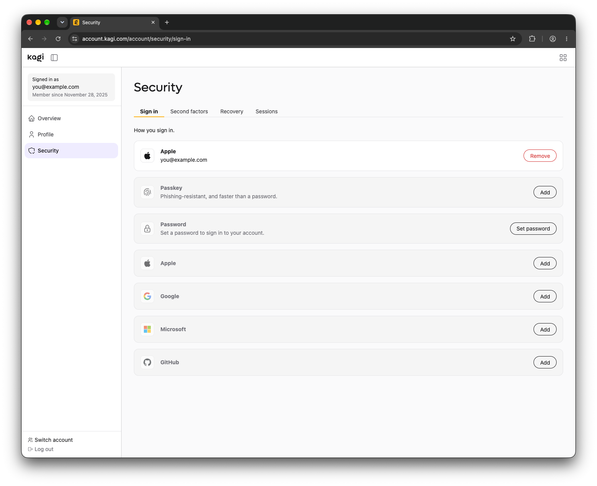
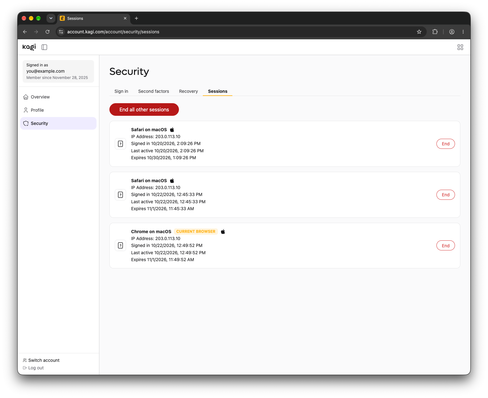

# Account Settings

Your **Kagi Account** at [account.kagi.com](https://account.kagi.com) controls how you sign in to every Kagi product.

Settings that only apply to one product, such as Kagi Search or Kagi Assistant, are managed in that product's own settings.

::: tip Set up 2FA before September 10th, 2026?
Your authenticator app will keep working, but your old backup codes were not transferred to the new Kagi Account. 

Go to [account.kagi.com](https://account.kagi.com/account/security/recovery) and open `Security` > `Recovery` to [generate new ones](../privacy/two-factor-authentication.md#backup-codes).
:::

## Sign in

{data-zoomable}

Choose how you sign in to Kagi. You can add more than one method and remove any you no longer use.

::: tip Try a passkey
Passkeys are phishing-resistant and faster than a password. They are stored on your device or in your password manager.
:::

## Second factors

{data-zoomable}

Add a second step when you sign in on a new device. Learn more in [Two-Factor Authentication](../privacy/two-factor-authentication.md).

## Recovery

{data-zoomable}

Reset your password by email, or generate backup codes to use if you lose access to your other methods. Store backup codes somewhere safe, such as your password manager.

## Sessions

{data-zoomable}

See every browser signed in to your account. Click `End` to sign out one session, or `End all other sessions` to sign out everywhere else.

::: warning Don't recognize a session?
End it, then change your password in [`Sign in`](#sign-in).
:::
